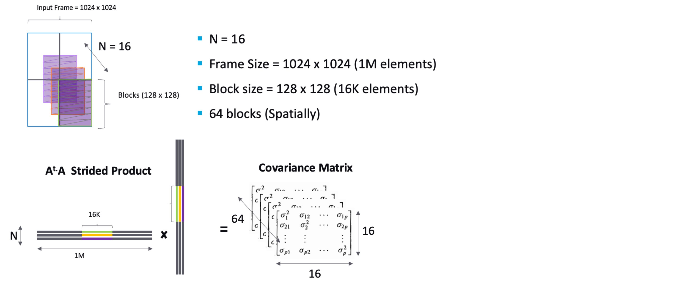

# Strided Batch Matrix Multiplications
Given an input matrix of dimensions H = 1024 x W = 1024 with 16 channels of FP16
 the objective is to divide the matrix into 128x128 disjoint blocks (16384
elements) spatially along the height and width. This results in a total of 64 blocks per
channel. Subsequently, each block from the 16 channels will undergo matrix multiplication
with its transpose to produce the final covariance matrix, as shown in the diagram.


using 
1. Custom Written Kernel
2. using CuBLAS
3. using Tensor Core

## To test the correctness of CPU Refrence 
> demo.cu file , for verifications of algorithm , same problem is scaled to
 smaller size , Matrix size : 1024 * 1024 -> 8 * 8 , Block Size : 128 * 128 -> 2 * 2 , 
 Number of channels : 16 -> 2

> Expected output : 16 symmetric matrix with size 2 * 2 
```sh
nvcc demo.cu
./a.out
```
```
channel : 0 
  3  6  7  5  3  5  6  2  9  1  2  7  0  9  3  6  0  6  2  6  1  8  7  9  2  0  2  3  7  5  9  2  2  8  9  7  3  6  1  2  9  3  1  9  4  7  8  4  5  0  3  6  1  0  6  3  2  0  6  1  5  5  4  7
channel : 1 
  6  5  6  9  3  7  4  5  2  5  4  7  4  4  3  0  7  8  6  8  8  4  3  1  4  9  2  0  6  8  9  2  6  6  4  9  5  0  4  8  7  1  7  2  7  2  2  6  1  0  6  1  5  9  4  9  0  9  1  7  7  1  1  5
block   0    119    135    135    178
block   1     74     78     78     99
block   2    135     80     80     94
block   3    126     45     45     41
block   4     76    108    108    213
block   5    195     70     70     90
block   6     17     12     12    101
block   7    159    167    167    185
block   8    198    159    159    169
block   9     50     35     35    105
block  10    172     91     91    103
block  11    145     82     82     93
block  12     70     29     29     38
block  13     46     56     56    203
block  14     41     13     13    131
block  15    115     79     79     76
```

## Build and run

```sh
make              # build both: main_cpu (CPU reference) and main_gpu (GPU)
make cpu          # build main_cpu only
make gpu          # build main_gpu only
make clean        # remove object files and binaries
make help         # list targets
```

> **IMPORTANT** Run the CPU version first, then the GPU version:
> - The CPU version creates the input.bin file , which is the input test cases ,
>  and then it computes and prints the output for refrence.
> - The same input.bin is used by different GPU version , which computes and print the results

## Step by Step procedure 

```sh
./main_cpu          > cpu.txt
./main_gpu --cublas > cublas.txt
./main_gpu --custom > custom.txt
./main_gpu --mma    > mma.txt

cmp cpu.txt cublas.txt && echo "cublas OK"
cmp cpu.txt custom.txt && echo "custom OK"
cmp cpu.txt mma.txt    && echo "mma OK"
```

## Profiling Reports [here](https://github.com/niraj-physics/KLA-strided_mm/blob/main/ncu_reports/README.md)

## Details 
### Architecture
```text
name       compute_cap   driver_version   memory.total [MiB]   clocks.max.sm [MHz]   clocks.max.memory [MHz]
Tesla T4   7.5           580.82.07        15360 MiB            1590 MHz              5001 MHz
```
### NVCC Versions
```text

nvcc: NVIDIA (R) Cuda compiler driver
Copyright (c) 2005-2025 NVIDIA Corporation
Built on Wed_Aug_20_01:58:59_PM_PDT_2025
Cuda compilation tools, release 13.0, V13.0.88
Build cuda_13.0.r13.0/compiler.36424714_0
```
## TODO

- [x] Naive CPU version to understand the problem statement
- [x] Tiled GPU kernel (`main.cu`)
- [X] Verify GPU output against the CPU output
- [X] Change input data type from `int` to `fp16`
- [ ] Improve Performance and Optimize
- [X] CuBLAS implementations 
- [X] Tensor Core implmentations 
- [ ] Calculate Theoretical Peak and roofline analysis
- [ ] Improve README
