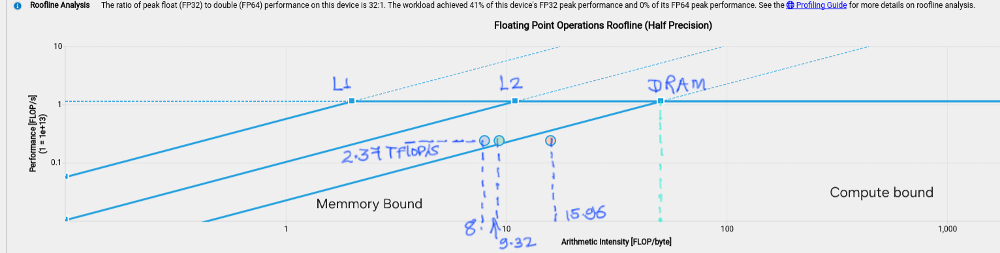
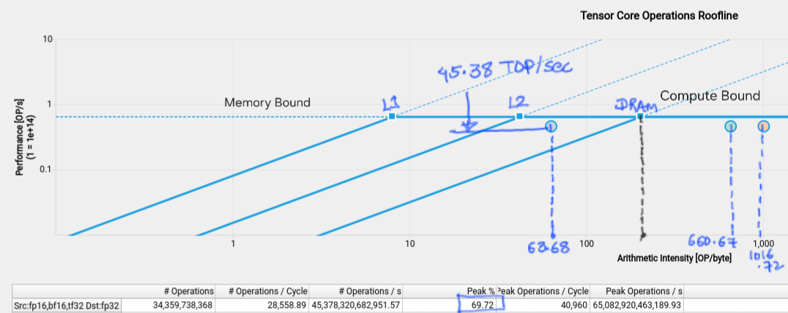
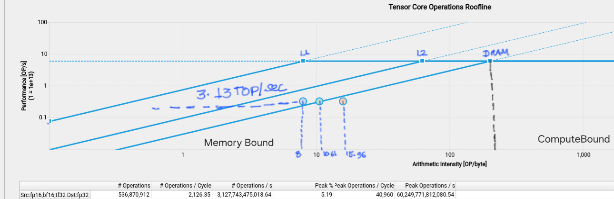

# custom Kernel 

## Duration [us]
226.82

## Roofline Analysis

| Memory Level | Arithmetic Intensity (FLOP/byte) | Performance (FLOP/s) |
|---|---:|---:|
| L1  | 8.00 | 2,366,988,713,318.28 |
| L2 | 15.96 | 2,366,988,713,318.28 |
| DRAM | 9.32 | 2,366,988,713,318.28 |

## Overall Analysis
Compute (SM) Throughput [%]	62.79

Memory Throughput [%]	111.31

> Memmory Bound 

**41% of FP32 peak performance**

# CUBLAS Kernel 
> cublasGemmAlgo_t : CUBLAS_GEMM_DEFAULT_TENSOR_OP

## Duration [us]
757.18

##  Roofline Analysis

| Memory Level | Arithmetic Intensity (OP/byte) | Performance (OP/s) |
|---|---:|---:|
| L1 | 63.68 | 45,378,320,682,951.57 |
| L2 | 1,016.72 | 45,378,320,682,951.57 |
| DRAM | 660.67 | 45,378,320,682,951.57 |

## Overall Analysis
Compute (SM) Throughput [%]	69.78

Memory Throughput [%]	36.45

> Compute Bound

**69.72% of  FP32 peak performance**

# Tensor Core (MMA  Kernel)

## Duration [us]
171.65

## Roofline Analysis 

| Memory Level | Arithmetic Intensity (OP/byte) | Performance (OP/s) |
|---|---:|---:|
| L1 | 8.00 | 3,127,743,475,018.64 |
| L2 | 15.96 | 3,127,743,475,018.64 |
| DRAM | 10.61 | 3,127,743,475,018.64 |

## Overall Analysis
Compute (SM) Throughput [%]	27.74

Memory Throughput [%]	98.73

Memmory Bound 

**achieved 5.19% FP32 peak performance**

# Summary
| Kernel | Duration [µs] | Peak used | % of that peak | DRAM throughput | Limiter |
|---|---:|---|---:|---:|---|
| Custom | 226.82 | FP32 @1.09 GHz = 5.58 TFLOP/s | 42% | 111% | DRAM saturated (L1/TEX 90%) |
| cuBLAS | 757.18 | FP16 tensor @1.59 GHz = 65.1 TFLOP/s | 69.7% (1.1% useful) | 21.5% | Tensor pipe busy on padded 128×128 tiles |
| MMA | 171.65 | FP16 tensor @1.00 GHz = 41.0 TFLOP/s | 7.6% | 98.7% | DRAM saturated |

The tensor core kernel is the fastest at 171.65 us, about 1.3x faster than the custom kernel. Both are limited by memory throughput (111.31% and 98.73% respectively), so neither reaches its compute ceiling. The cuBLAS kernel is compute bound, with the highest SM throughput (69.78%) and only 36.45% memory throughput.

# Peak Throughput
## Architecture specs used (Tesla T4, Turing TU104, sm_75)

| Parameter | Value | Source |
|---|---|---|
| SMs | 40 | ncu report (Launch Statistics: "# SMs") |
| FP32 CUDA cores per SM | 64 | Turing architecture spec |
| FLOP per FMA | 2 (multiply + add) | Standard convention |
| Tensor Cores per SM | 8 (320 total) | Turing architecture spec |
| Tensor Core FP16 throughput | 64 FMA/clk per core = 128 FLOP/clk | Turing architecture spec |
| Boost clock (spec) | 1.59 GHz | T4 datasheet; repo README |
| Published FP32 peak | 8.1 TFLOP/s | T4 datasheet |
| Published FP16 tensor peak | 65 TFLOP/s | T4 datasheet |

[Refrence](https://www.itcreations.com/nvidia-gpu/nvidia-tesla-t4-gpu#specifications)

## Formulas

- FP32 peak = SMs × 64 × 2 × SM clock = 5,120 FLOP/clk × SM clock
- FP16 tensor peak = SMs × 8 × 128 × SM clock = 40,960 FLOP/clk × SM clock

## Peak throughput per report

| Report | SM clock | FP32 peak | FP16 tensor peak |
|---|---|---|---|
| custom | 1.09 GHz | 5.58 TFLOP/s | 44.6 TFLOP/s |
| mma | 1.00 GHz | 5.12 TFLOP/s | 41.0 TFLOP/s |
| cuBLAS | 1.59 GHz | 8.14 TFLOP/s | 65.1 TFLOP/s |
| spec (boost) | 1.59 GHz | 8.14 TFLOP/s | 65.1 TFLOP/s |
